# NBA Spatial Shot Analysis & Playstyle Mapping System

A production-ready data engineering and advanced spatial analysis pipeline designed to dissect NBA shooting efficiency, evaluate predictive feature dynamics, and profile player tendencies. This system seamlessly fuses raw play-by-play sheets with high-fidelity optical tracking metrics, extracts high-signal tracking variables using glass-box classifiers, and maps multi-dimensional player archetypes onto custom-calibrated shot zone heatmaps.

*Note: This repository represents a complete spatial data pipeline. The feature discovery core (EBM continuous splines) and playstyle baselines (K-Means shot zone heatmaps) are fully operational, paving the way for a final blended predictive framework designed to stack these components together to predict individual player shot success vectors.*

---

## Project Development Status

*   **Phase 1: Predictive Modeling & Feature Discovery**
    *   Fused cross-vendor data, executed strict physical constraint filtering, benchmarked classifiers, and extracted glass-box visual insights.
*   **Phase 2: Player-Archetype Shot Zone Baseline**
    *   Classified players into 6 unique tactical archetypes using K-Means, verified them via 2D PCA, and mapped absolute shooting efficiencies on a 5-tier high-contrast shot zone heatmap grid.
*   **Phase 3: Blended Logistic Regression (In Development)**
    *   Integrating aggregated shot zone baseline metrics with advanced tracking variables into a calibrated inference model.

---

## 1. Data Procurement & Integration

To build an advanced predictive model, we must fuse two entirely separate historical datasets because **high-fidelity player tracking metrics are not natively integrated into standard NBA box scores**:

1. **`nba_api_2014-15_shots.csv`:** Extracted via the official `nba_api` Python client. Provides official play-by-play event definitions (`ACTION_TYPE`, `SHOT_TYPE`), spatial court coordinates (`LOC_X`, `LOC_Y`), and official success states (`SHOT_MADE_FLAG`).
2. **`shot_logs(in).csv`:** Sourced from the public [Kaggle NBA Shot Logs Dataset](https://www.kaggle.com/datasets/dansbecker/nba-shot-logs). Sourced from optical tracking arrays, providing unique contextual tracking metrics such as `CLOSEST_DEFENDER`, `CLOSE_DEF_DIST`, `TOUCH_TIME`, and `DRIBBLES`.

### Pipeline Quality Control & Synchronization Constraints
To resolve sub-second clock drift and sensor noise across vendors, row pairings are aligned using strict multi-level filters:
* **Spatio-Temporal Sync**: Restricted to a maximum window of `TIME_DIFF <= 5` seconds and a spatial boundary of `DIST_DIFF <= 3` feet.
* **Possession Quality Audits**: Dropped tracking anomalies consisting of **3,358 records with `TOUCH_TIME == 0`** and **312 records with `TOUCH_TIME < 0`** along with a final `.dropna()` integrity sweep.
* **Pipeline Yield**: Reduced the original tracking pool from 128,069 rows to **95,892 clean records** saved to `data/shotlog_2014-15_preprocessed.csv` (**74.9% data retention rate**).

### Dataset Feature Profile & Distributions
The matrix below captures the continuous and categorical distributions across our final sanitized 95,892-row ground truth:

<p align="center">
  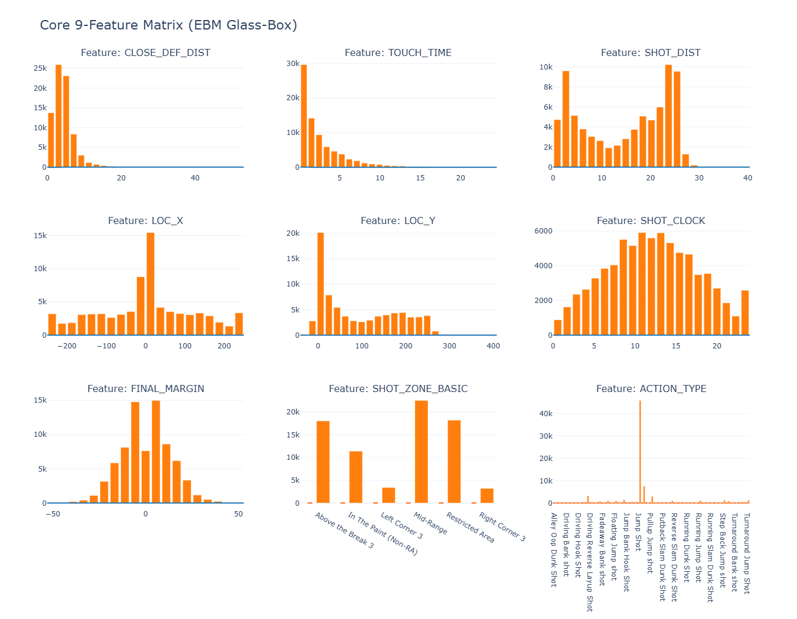
</p>

---

## 2. Model Evaluation & Interpretability (XAI)

Model interpretability is a strict system constraint. We benchmarked an **XGBoost** classifier against a transparent **Explainable Boosting Machine (EBM)** over our sanitized validation data (`test_size=0.2`).

### Performance Matrix

| Metric | XGBoost (Black-Box) | EBM (Glass-Box) | Strategic Winner |
| :--- | :---: | :---: | :---: |
| **Classification Accuracy** | 64.20% | **64.95%** | **EBM (+0.75%)** |
| **Area Under ROC (ROC-AUC)** | 0.6833 | **0.6954** | **EBM (+0.0121)** |
| **Logarithmic Loss (LogLoss)** | 0.6257 | **0.6161** | **EBM (Lower is Better)** |

---

### XGBoost Interpretations (Black-Box)

To evaluate global feature impacts on our baseline black-box model, we extracted classic global metric weight profiles to audit overall variance contributions:

<table align="center">
  <tr>
    <td align="center"><b>Global Feature Importance (MDI/Weight Bar)</b></td>
    <td align="center"><b>SHAP Beeswarm Feature Impact Summary</b></td>
  </tr>
  <tr>
    <td>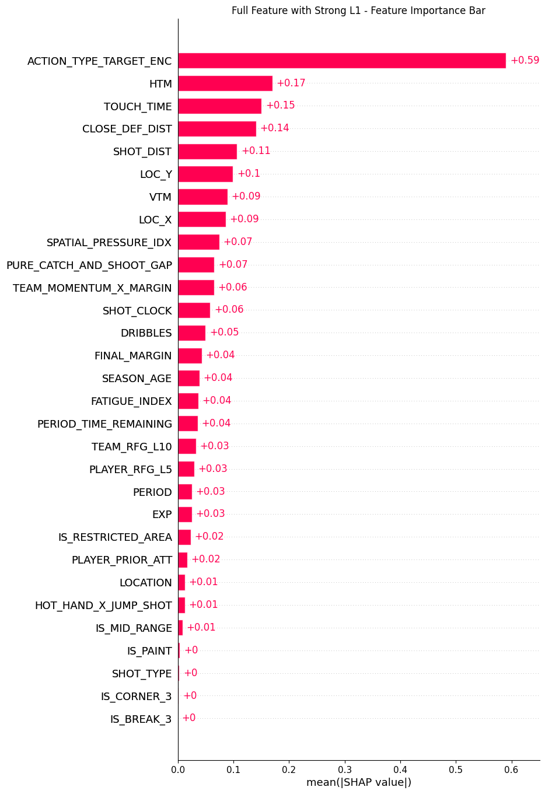</td>
    <td>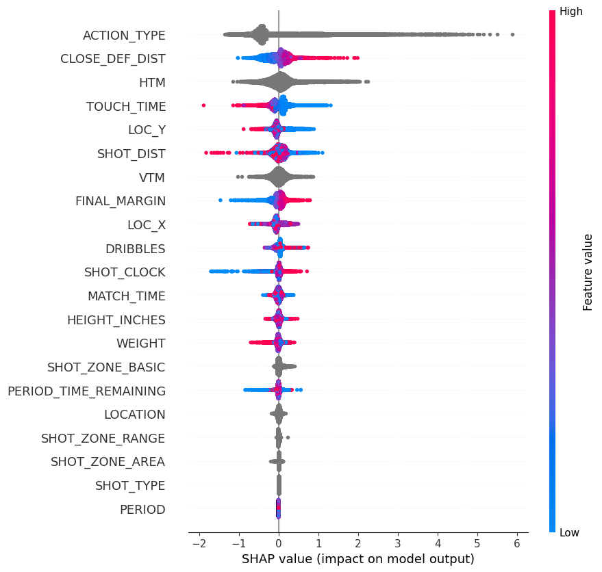</td>
  </tr>
</table>

While the global bar chart flags which features dominate split modifications, the SHAP beeswarm plot reveals structural directionality (e.g., how decreasing `CLOSE_DEF_DIST` shifts shot values drastically toward negative impacts on completion probability).

---

### EBM Interpretation & Feature Importance Discovery (Glass-Box)

By deploying a Glass-Box model, we pulled back the curtain on the AI's internal basketball logic. Below is the global feature importance ranking generated directly by our trained EBM classifier:

<p align="center">
  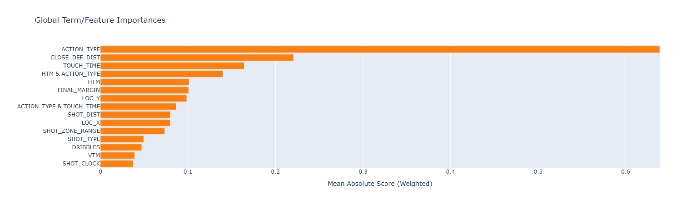
</p>

### High-Signal Feature Deep Dives
* **Defender Proximity (`CLOSE_DEF_DIST`)**: Captures a steep surge in shot success as a shooter creates space from 2 to 4 feet, plateauing past 6 feet into a steady "open shot" score. Extreme gaps (>25 ft) spike sharply, capturing breakaway transition layups.
* **Rushing Constraints (`SHOT_CLOCK` & `TOUCH_TIME`)**: EBM isolates optical tracking errors (unrealistic negative values from chaotic tip-ins) and penalizes them heavily. The `SHOT_CLOCK` curve remains surprisingly flat, proving a dying clock's impact is absorbed by overlapping spatial drops (defenders closing out tightly) rather than the timer itself.
* **Spatial Geometry (`ACTION_TYPE`)**: The single most dominant feature. Explosive close-range actions (e.g., `Driving Dunk Shots`) receive maximum positive probability weights (up to +5), while standard `Jump Shots` flatten near zero due to an even distribution of makes and misses.

<table align="center">
  <tr>
    <td>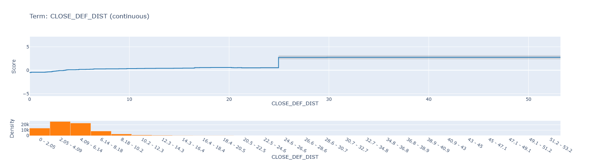</td>
    <td>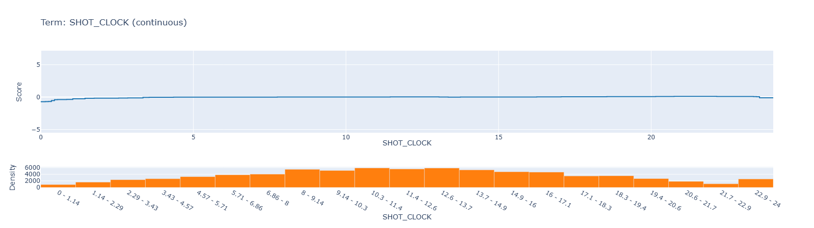</td>
    <td>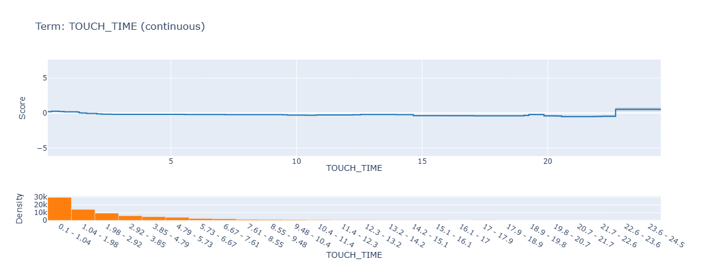</td>
    <td>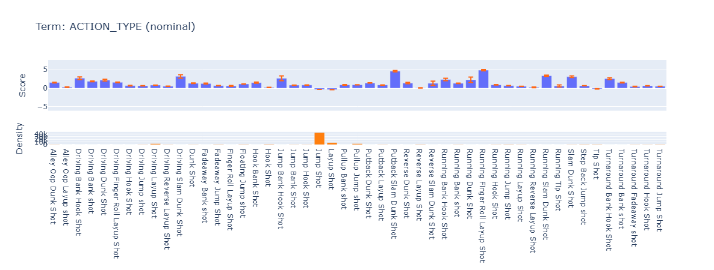</td>
  </tr>
</table>

---

## 3. Unsupervised Clustering & Spatial Validation (PCA)

To resolve data sparsity, players with ≥ 50 total shots were mapped into 6 distinct tactical profiles across 5 playstyle features. 

*   **PCA Dimensionality Reduction**: **PC1 and PC2 explain 94.72% of the original variance**, validating clean group boundaries with minimal information loss.
*   **Validation Star Tracking**: 9 iconic 2014-15 stars were annotated to audit cluster logic.

<p align="center">
  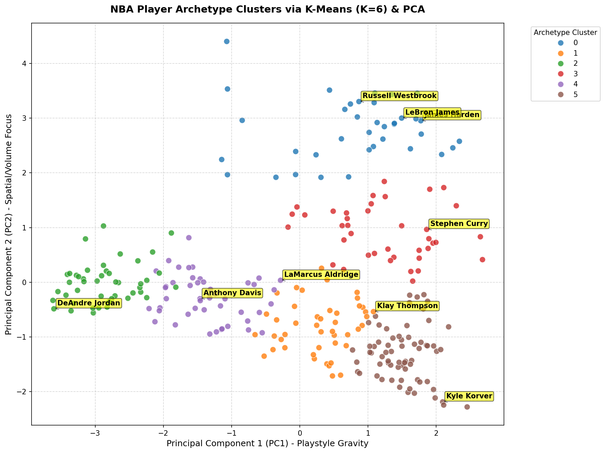
</p>

### Cluster Tactical Profiles
*   **Cluster 0 ── Elite Playmakers / Slashers** (Harden, Westbrook): High ball dominance (`AVG_TOUCH`: 4.98s, `AVG_DRIBBLES`: 4.83).
*   **Cluster 1 ── Secondary Playmakers / Dynamic Wings**: Balanced self-creators (`THREE_RATE`: 46.1%, `AVG_TOUCH`: 3.51s).
*   **Cluster 2 ── Low-Post Bigs / Pick-and-Pop** (Aldridge, Davis): Skilled interior players with mid-range jumpers (`PAINT_RATE`: 57.5%).
*   **Cluster 3 ── Rim Protectors / Pure Roll-Men** (DeAndre Jordan): Paint-bound blue-collar roll threats (`PAINT_RATE`: 86.8%, 0-dribble lobs).
*   **Cluster 4 ── Pure Catch-and-Shoot / 3&D** (Korver, Klay): Off-ball snipers with instant trigger mechanisms (`THREE_RATE`: 62.0%).
*   **Cluster 5 ── Mid-Range Role Players**: Utility role forwards relying heavily on stationary mid-range spot-ups.

---

## 4. Spatial Shot Zone Heatmaps

By leveraging the foundational court drawing frameworks from [Bradley Fay (py-Goldsberry)](https://github.com/bradleyfay/py-Goldsberry) and [Savvas Tjortjoglou](http://savvastjortjoglou.com/nba-shot-sharts.html), this project applies **custom geometric micro-adjustments** to replicate official NBA court specifications with flawless mathematical accuracy:
* **Corner Three Lines**: Calibrated to exactly **`136.977`** units high to form a perfect tangent with the arc.
* **Three-Point Arc Theta**: Formulated precisely from **`22.132°` to `157.868°`** for seamless line intersections.

Efficiencies are mapped using a **5-tier absolute color scale** (🟢 Deep Green ≥ 56% | 🟩 Green 44%-56% | 🟨 Yellow 36%-44% | 🟥 Red 28%-36% | 🔴 Deep Red < 28%).

### Stephen Curry Shot Chart
<p align="center">
  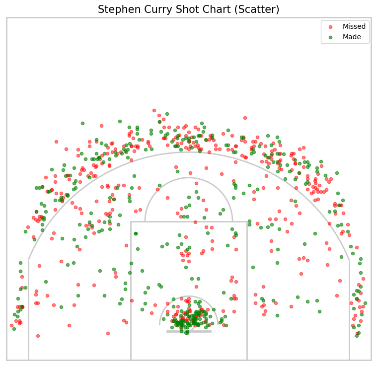
</p>

### Overall League Average Shot Zone Map
<p align="center">
  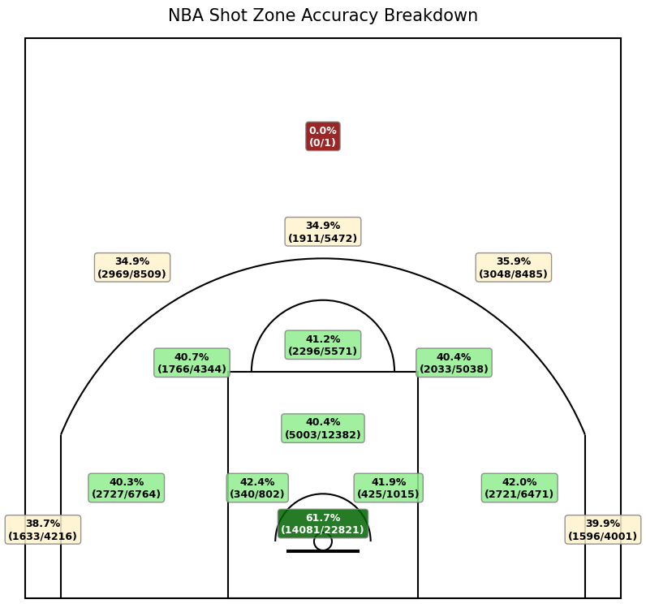
</p>

### Cluster-Based Shot Zone Efficiency Maps
<p align="center">
  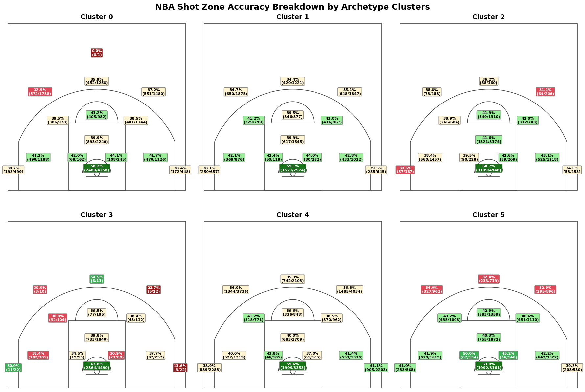
</p>

### References
* **Bradley Fay** – [py-Goldsberry Repository (Jupyter Notebook Documentation)](https://github.com/bradleyfay/py-Goldsberry/blob/main/docs/Visualizing%20NBA%20Shots%20with%20py-Goldsberry.ipynb)
* **Savvas Tjortjoglou** – [How to Create NBA Shot Charts in Python Tutorial](http://savvastjortjoglou.com/nba-shot-sharts.html)

---

## Future Work: NBA Spatial Shot Probability Prediction System 

*The framework below outlines the advanced advanced predictive pipeline currently under active development:*

This upcoming upgrade is designed as a production-ready data engineering and advanced predictive modeling pipeline to calculate highly calibrated individual player shot success probabilities. It seamlessly fuses raw play-by-play logs with high-fidelity optical tracking metrics, extracts non-linear features using glass-box classifiers, and blends spatial shot zone benchmarks to predict exact shot completion probabilities.

---

## 📂 Repository Structure
```text
├── data/
├── image/
├── data_cleaning.ipynb
├── model_benchmarks.ipynb      # XGBoost vs. EBM machine learning benchmarks
├── zone_stat.ipynb             # Localized shot zone percentage aggregations
├── cluster.ipynb               # Player profiling & K-Means modeling
├── heatmap.ipynb               # Shot zone heatmap
├── README.md
└── requirements.txt
```
